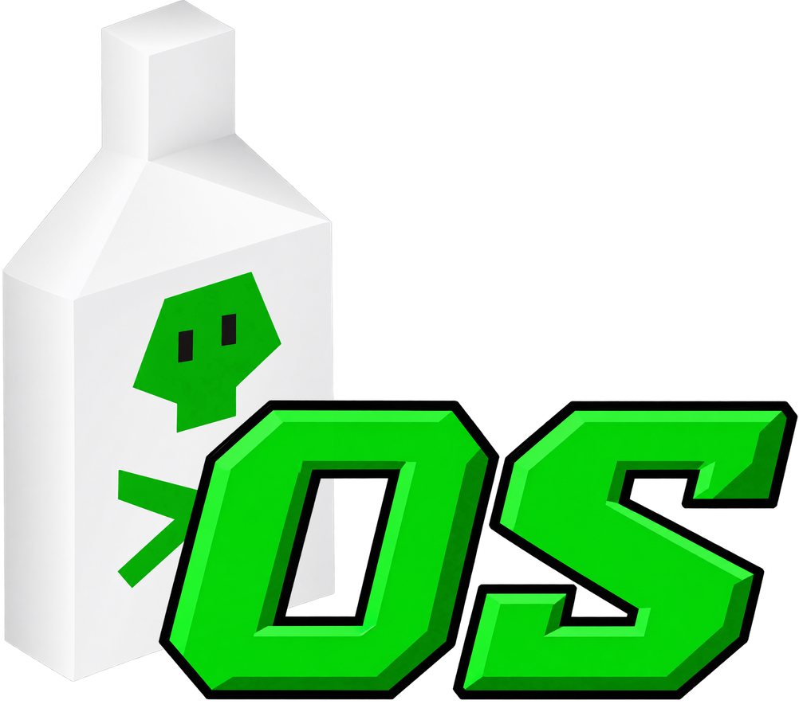

<p align="center"></p>

# PoisonOS

An operating-system layer written entirely in Elixir.

## Goals

- Core OS concepts (processes, scheduling, memory, filesystem, IPC, shell) built as OTP applications
- Small, tested modules with no external dependencies
- Runs on the BEAM; bootable targets (for example via Nerves) come later

## Development

```
mix test
```

Planned work lives in [ROADMAP.md](ROADMAP.md).
